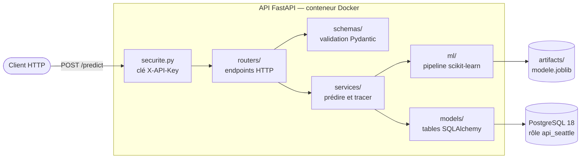
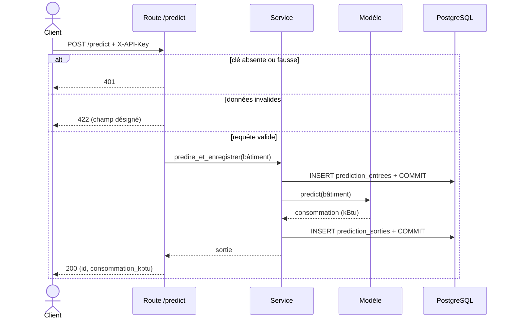
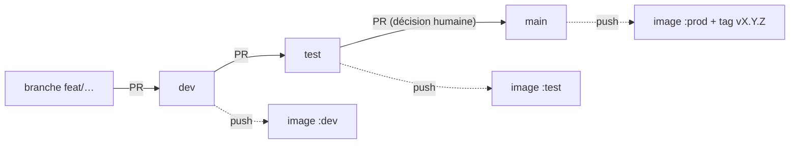

# Architecture

## Vue d'ensemble

Le code est organisé **en couches** : chaque dossier a une responsabilité, et les dépendances vont
dans un seul sens (`routers` → `services` → `ml` et `models`) : une couche basse n'importe jamais
une couche haute.

| Couche        | Responsabilité                                         | Ne fait pas                         |
|---------------|--------------------------------------------------------|-------------------------------------|
| `routers/`    | traduire HTTP ↔ appel de service (contrôleur)         | de logique métier                   |
| `schemas/`    | contrat d'entrée et de sortie, validation (DTO)        | d'accès à la base                   |
| `services/`   | logique : tracer l'entrée, prédire, tracer la sortie   | de HTTP                             |
| `ml/`         | préparation des données, pipeline, chargement du modèle | d'accès à la base                  |
| `models/`     | tables de la base                                      | de logique                          |
| `securite.py` | authentification                                       |                                     |
| `config.py`   | constantes, chemins, réglages (une seule source de vérité) |                                 |

Les dépendances (session de base, modèle, réglages) sont **injectées** par FastAPI (`Depends`) au
lieu d'être créées dans les routes : les tests les remplacent sans toucher au code.

## Une prédiction, pas à pas

Une requête refusée (401, 422) n'atteint ni le modèle ni la base. Une requête valide est tracée
avant l'appel au modèle : si celui-ci échoue, l'API renvoie 500 et l'entrée reste en base, sans
sortie.

## Du commit à la production

| Événement                    | Job       | Ce qui se passe                                                         |
|------------------------------|-----------|-------------------------------------------------------------------------|
| push, pull request           | `quality` | lint, formatage, entraînement, création de la base, tests + couverture (seuil 95 %) |
| fusion dans `dev`/`test`/`main` | `deploy` | image Docker construite, lancée et appelée (test de fumée), publiée sur GHCR |

Les fusions vers `dev` et `test` sont automatiques dès que la CI est verte (`quality
(pull_request)`, check obligatoire). Le passage en production (`test` → `main`) reste manuel.
Détails : [CONTRIBUTING.md](../CONTRIBUTING.md).

## Choix techniques

| Besoin                    | Choix                         | Pourquoi                                                                 | Écarté                                    |
|---------------------------|-------------------------------|--------------------------------------------------------------------------|-------------------------------------------|
| Exposer le modèle         | **FastAPI**                   | validation par les types, Swagger généré, injection de dépendances      | Flask (validation et doc à la main) ; Gradio (interface de démo, pas une API) |
| Valider les entrées       | **Pydantic**                  | types, bornes et listes fermées déclarés une fois, erreurs 422 précises | validation manuelle                       |
| Modèle                    | **pipeline scikit-learn**     | le preprocessing voyage avec le modèle : aucun écart entraînement / production | preprocessing recodé dans l'API     |
| Base de données           | **PostgreSQL 18**             | rôles et droits fins, contraintes, même moteur en test et en production  | SQLite (pas de rôles, pas de concurrence) |
| Accès à la base           | **SQLAlchemy 2 + psycopg 3**  | ORM recommandé par l'énoncé, requêtes paramétrées (pas d'injection SQL) | SQL brut partout                          |
| Authentification          | **clé d'API** (`X-API-Key`)   | accès entre machines, sans utilisateurs à gérer                          | OAuth2 / JWT (pas de comptes utilisateurs) |
| Environnement Python      | **uv**                        | versions exactes figées (`uv.lock`), installation rapide                 | pip + requirements.txt                    |
| Qualité du code           | **ruff**, **pytest**, **pytest-cov** | un outil par besoin, rapides, standards                           |                                           |
| Livraison                 | **Docker**, image sur **GHCR** | se lance à l'identique partout ; gratuit pour un dépôt public          | Hugging Face Spaces (Docker payant depuis 2026) |
| CI/CD                     | **GitHub Actions**            | intégré au dépôt, environnements et secrets par branche                  |                                           |
| Branches                  | **GitLab Flow** (`dev`/`test`/`main`) | une branche par environnement, promotion par pull request        | GitHub Flow (un seul environnement)       |
| Documentation             | **Markdown + Mermaid** sur GitHub, **Swagger** pour l'API | lus directement sur GitHub, à côté du code | MkDocs / Sphinx (un site à construire et maintenir en plus) |
