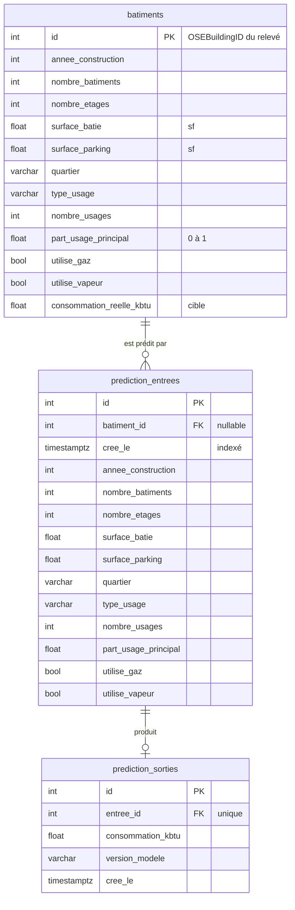

# Base de données

PostgreSQL 18 stocke le dataset d'entraînement et **trace chaque échange avec le modèle** : ce qui
lui a été envoyé, ce qu'il a répondu, quand, et avec quelle version.

## Schéma



| Table                | Contenu                                                     | Lignes            |
|----------------------|-------------------------------------------------------------|-------------------|
| `batiments`          | les 1 582 bâtiments du relevé 2016 retenus après nettoyage  | fixe              |
| `prediction_entrees` | chaque bâtiment envoyé au modèle                            | une par requête   |
| `prediction_sorties` | la réponse du modèle pour une entrée                        | une par entrée    |

### Choix de conception

- **Entrées et sorties dans deux tables.** L'entrée est enregistrée *avant* l'appel au modèle, la
  sortie *après*. Si le modèle échoue, l'entrée reste sans sortie : la tentative est tracée
  (requête n° 2 de `scripts/requetes.sql`). Relation 1-1 garantie par la contrainte `unique` sur
  `entree_id`.
- **`batiment_id` facultatif.** Renseigné quand la prédiction porte sur un bâtiment du dataset : on
  peut alors comparer prédiction et consommation réelle en SQL. Vide pour un client de l'API.
- **Les 11 champs métier sont les mêmes partout** (`batiments`, `prediction_entrees`, schéma
  Pydantic de l'API, colonnes d'entraînement du modèle). Côté code, ils sont définis une seule fois
  dans un mixin SQLAlchemy (`app/models/champs.py`).
- **`id` des bâtiments = `OSEBuildingID`** du relevé : chaque ligne se retrouve dans le fichier
  source.
- **`version_modele`** sur chaque sortie : après un réentraînement, on sait quel modèle a répondu
  quoi.
- **Volume** : les tables de prédictions grossissent à chaque requête. `cree_le` et `batiment_id`
  sont indexés pour interroger l'historique par période ou par bâtiment sans parcourir toute la
  table.
- **Horodatage par PostgreSQL** (`DEFAULT now()`) : une seule horloge de référence, quel que soit
  le serveur qui appelle.
- **Le dataset nettoyé, pas le relevé brut.** La table contient exactement les bâtiments sur
  lesquels le modèle a appris. Le relevé brut (3 376 lignes, dont des logements hors périmètre et
  des lignes incohérentes) reste intact dans `data/raw/`.

## Gestion des accès

Deux comptes PostgreSQL, deux usages :

| Compte        | Utilisé par                                   | Droits                                                    |
|---------------|-----------------------------------------------|-----------------------------------------------------------|
| `admin`       | `scripts.create_db`, `scripts.load_dataset`   | propriétaire de la base                                   |
| `api_seattle` | l'API et les scripts qui prédisent ou lisent  | `SELECT` sur `batiments` ; `SELECT, INSERT` sur les prédictions |

- L'API ne reçoit **jamais** les identifiants administrateur.
- Ni `UPDATE` ni `DELETE` pour l'API : même compromise, elle ne peut ni falsifier l'historique des
  prédictions ni toucher au dataset. Les tests le vérifient (`tests/unit/test_database.py`).
- Le port de PostgreSQL n'est ouvert que sur `127.0.0.1` : la base n'est pas joignable depuis le
  réseau.
- Les mots de passe sont dans `.env` (jamais commité), générés aléatoirement.

## Mise en place

```bash
docker compose up -d db                  # PostgreSQL 18
uv run python -m scripts.create_db       # rôle de l'API, tables, droits (relançable)
uv run python -m scripts.load_dataset    # 1 582 bâtiments (ne fait rien s'ils y sont déjà)
```

## Interagir avec les données et le modèle

| Script                                         | Rôle                                                                      |
|------------------------------------------------|---------------------------------------------------------------------------|
| `uv run python -m scripts.predire_batiments 5` | prédit 5 bâtiments tirés de la base et compare au réel (tracé en base)   |
| `uv run python -m scripts.exporter_predictions` | exporte l'historique (entrée + sortie) en CSV                             |
| `scripts/requetes.sql`                         | requêtes d'exemple : dernières prédictions, échecs, erreur, volume…       |

```bash
docker compose exec -T db psql -U admin -d seattle_energy < scripts/requetes.sql
```

**Exemples d'entrées et de sorties** : [`docs/exemples/predictions.csv`](exemples/predictions.csv),
export de 10 prédictions (8 sur des bâtiments du dataset, avec leur consommation réelle, et 2
requêtes de clients de l'API).

Attention en lisant les écarts des bâtiments du dataset : 80 % d'entre eux ont servi à
l'entraînement, l'écart y est donc optimiste. La performance du modèle se mesure sur le jeu de test
(`artifacts/metriques.json`, voir le README).
